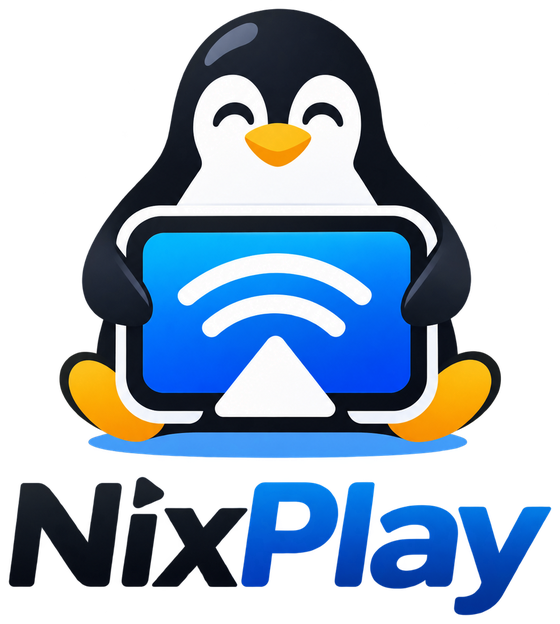
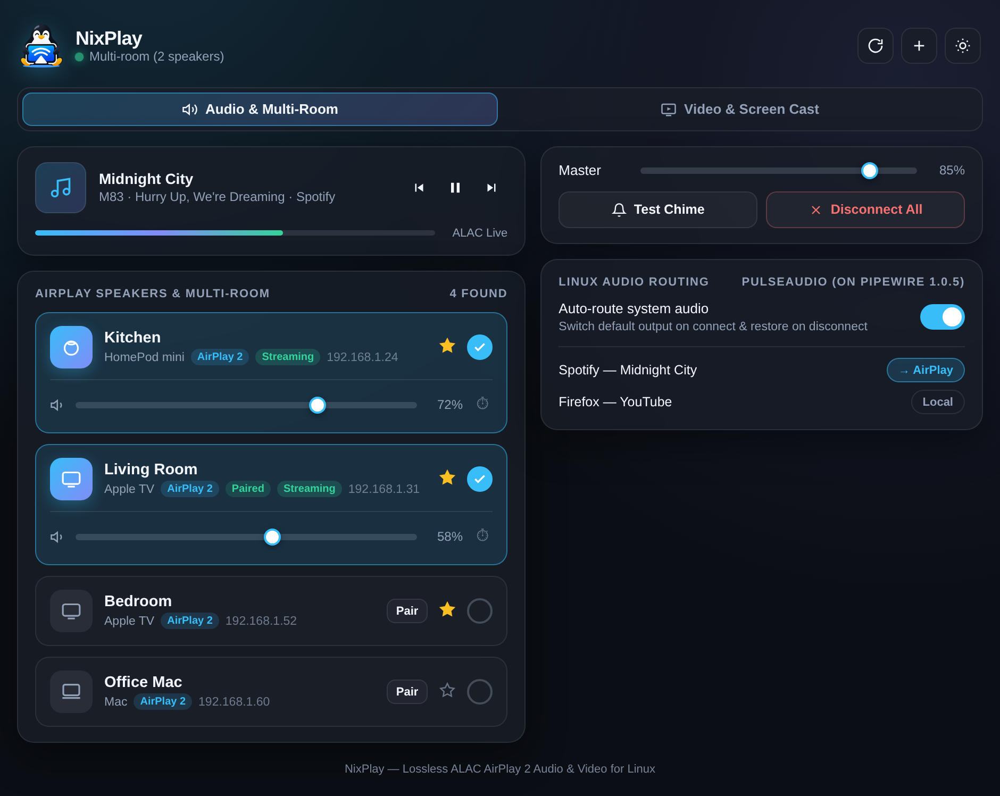
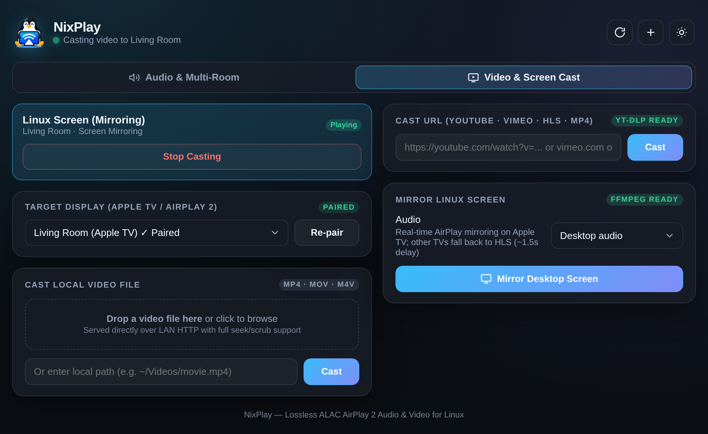
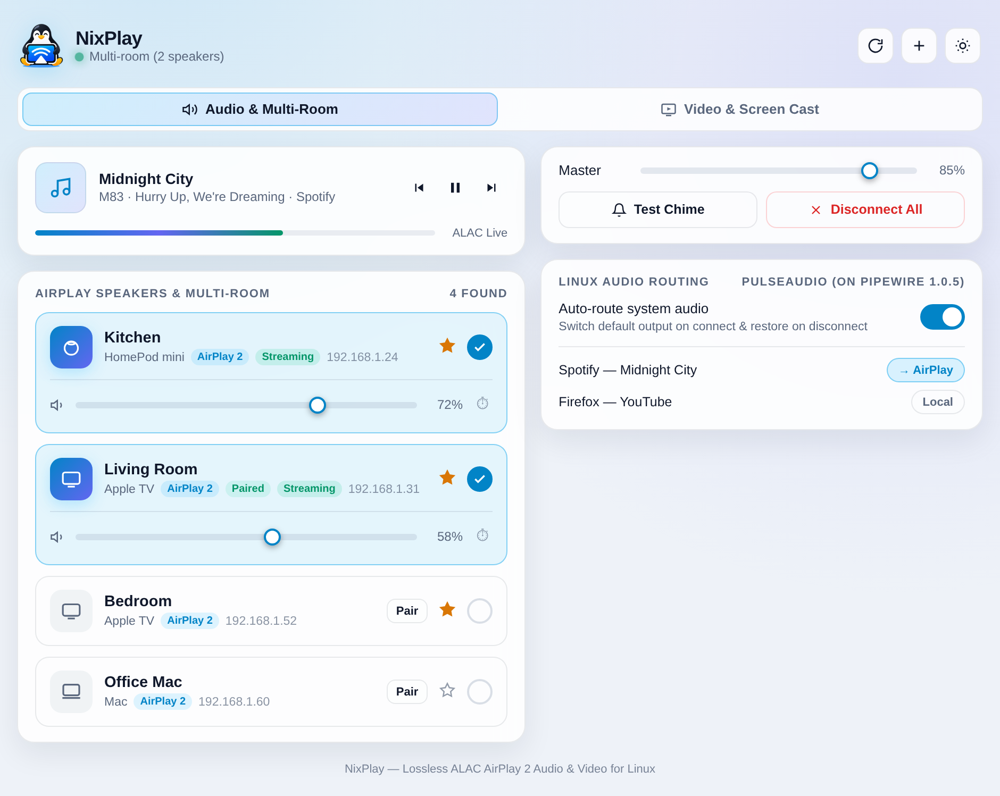

<p align="center">
  
</p>

<p align="center">
  <strong>Friendly, polished AirPlay 2 &amp; AirPlay 1 (RAOP) audio and video sender for Linux.</strong><br>
  Stream music, games, movies, or your live desktop to <strong>HomePod</strong>, <strong>HomePod mini</strong>, <strong>Apple TV</strong>, <strong>Mac</strong>, and other AirPlay receivers — from <strong>Linux Mint</strong>, <strong>Steam Deck</strong>, <strong>Raspberry Pi</strong>, or any Linux distro.
</p>

---

## Screenshots

<p align="center">
  
</p>
<p align="center"><em>Multi-room lossless ALAC streaming, per-speaker volume &amp; sync offset, and per-app audio routing</em></p>

<p align="center">
  
  &nbsp;
  
</p>
<p align="center"><em>Left: real-time screen mirroring, URL and file casting to Apple TV · Right: Light Mode</em></p>

---

## One-Line Install

Works on **Linux Mint**, **Ubuntu**, **Debian**, **Fedora**, **Arch**, **Steam Deck (SteamOS)**, and **Raspberry Pi (ARM64)** — installs cleanly in your home folder (`~/.local/bin/nixplay`) with **no `sudo` required**:

```bash
curl -fsSL https://raw.githubusercontent.com/mrsco/nixplay/main/install.sh | bash
```

Or if you already cloned the repository:

```bash
./install.sh
```

> **What the installer does:**
> 1. Installs the Rust toolchain in user-space (`~/.cargo`) if you don't already have it.
> 2. Compiles a single self-contained native binary (`~/.local/bin/nixplay`) with zero external codec or C-dev dependencies.
> 3. Adds **NixPlay AirPlay** to your desktop application menu and configures your `PATH`.

---

## Quick Start (Desktop — Linux Mint, Ubuntu, Fedora, Arch, KDE, GNOME)

1. **Launch NixPlay** from your application menu (**NixPlay AirPlay**), or run:
   ```bash
   nixplay serve --open
   ```
2. **Pick your speakers** — NixPlay automatically discovers every HomePod, Apple TV, Mac, and AirPlay receiver on your Wi-Fi/LAN.
   - Click a speaker card to connect (or click multiple speakers for **synchronized multi-room audio**).
   - NixPlay automatically creates a virtual `NixPlay AirPlay` output in PipeWire/PulseAudio, routes your system audio to it, and restores your regular speakers when you disconnect.
   - Want to send **only Spotify or Firefox** to your HomePod while keeping game/system sounds local? Toggle individual apps in the **Linux Audio Routing** card.
3. **Click the AirPlay icon in your system tray** anytime to toggle speakers, adjust volume, or re-open the Control Center window (also always available in any browser at [http://127.0.0.1:17420](http://127.0.0.1:17420)).

---

## Pairing Apple TV (One-Time 4-Digit PIN)

HomePods connect immediately with zero PIN. Apple TVs ask for a one-time 4-digit on-screen code:

- **In the UI:** Click **Pair** next to your Apple TV → enter the 4-digit code shown on your TV → done! Credentials are saved permanently in `~/.config/nixplay/config.toml` and work automatically for both **Audio** and **Video**.
- **In the terminal:**
  ```bash
  nixplay pair "Living Room"
  ```

---

## Casting Video & Live Desktop Screen to Apple TV

Switch to the **Video & Screen Cast** tab in NixPlay (or use the CLI):

### 1. Cast Local Video Files (`MP4`, `MOV`, `M4V`)
Drag and drop a video file right into the NixPlay window, enter a file path, or run:
```bash
nixplay cast "Living Room" ~/Videos/movie.mp4
```
NixPlay serves the file directly from its built-in LAN HTTP server with full `206 Partial Content` seeking, live timeline scrubbing, Play/Pause, and Stop controls — no `ffmpeg` needed.

### 2. Cast Web Video or HLS Streams (`.m3u8`)
Paste any direct MP4 or HLS stream URL in the UI, or run:
```bash
nixplay cast "Living Room" https://example.com/stream.m3u8
```

### 3. Mirror Your Live Linux / Steam Deck Screen
On Apple TV, NixPlay uses **real AirPlay screen mirroring**: the same protocol as an iPhone or Mac, with about 0.1s of delay plus desktop audio. Receivers that don't support it fall back to a low-latency HLS stream (~1.5s). Both need `ffmpeg` (the installer adds it):
```bash
sudo apt install ffmpeg   # Debian / Ubuntu / Linux Mint / Raspberry Pi OS
```
Then click **Mirror Desktop Screen** in the UI (pick *Desktop audio*, *Desktop + microphone*, or *No audio*), or run:
```bash
nixplay cast-screen "Living Room"              # desktop audio
nixplay cast-screen "Living Room" --mic        # desktop audio + microphone
nixplay cast-screen "Living Room" --no-audio
```

---

## Steam Deck & Raspberry Pi Guide

### Steam Deck (SteamOS)
- `./install.sh` installs strictly into `~/.local/bin` — **zero writes to the immutable SteamOS root filesystem**, so SteamOS updates never wipe NixPlay.
- In **Desktop Mode**, launch **NixPlay AirPlay** from the app menu or tray.
- In **Game Mode** (or from your phone while docked), run NixPlay with `--bind 0.0.0.0` and control speakers at `http://<steamdeck-ip>:17420`.

### Raspberry Pi / Headless Linux Server
Run NixPlay in headless LAN mode so you can control your speakers from any phone, tablet, or browser on your network:

```bash
nixplay serve --bind 0.0.0.0 --no-tray
```

Then open `http://<raspberry-pi-ip>:17420` from your phone.

To start NixPlay automatically on boot as a systemd user service:

```bash
mkdir -p ~/.config/systemd/user
cp desktop/nixplay.service ~/.config/systemd/user/
systemctl --user daemon-reload
systemctl --user enable --now nixplay.service
```

---

## CLI Cheat Sheet

| Command | Description |
| :--- | :--- |
| `nixplay` | Start daemon + system tray + Web Control Center (`http://127.0.0.1:17420`) |
| `nixplay serve --open` | Start NixPlay and immediately open the Control Center window |
| `nixplay serve --bind 0.0.0.0 --no-tray` | Headless / LAN remote control mode (Raspberry Pi, servers, Steam Deck) |
| `nixplay scan` | List all discovered AirPlay 2 & AirPlay 1 receivers on the network |
| `nixplay pair "Living Room"` | One-time 4-digit PIN pairing with an Apple TV or Mac |
| `nixplay stream "Kitchen" "Living Room"` | Stream system audio to one or more speakers from the terminal |
| `nixplay cast "Living Room" movie.mp4` | Cast a local video file or HTTP/HLS URL to Apple TV |
| `nixplay cast-screen "Living Room"` | Mirror your Linux screen + audio to Apple TV in real time (requires `ffmpeg`) |
| `nixplay test "Kitchen" --chime` | Play a gentle test chime to verify a speaker |

---

## Features Under the Hood

- **Pure Rust, Single Binary** — compiles cleanly with zero C-dev headers (`libpulse-dev`, `libgtk-dev`, etc. not required).
- **AirPlay 2 + AirPlay 1 (RAOP)** — HAP transient pairing (SRP-6a 3072-bit SHA-512), HAP PIN pairing + `pair-verify` (Ed25519 + X25519), ChaCha20-Poly1305 encrypted RTSP/event/RTP channels, lossless 44.1 kHz / 16-bit stereo ALAC encoding, NTP clock sync, and packet retransmission.
- **Automatic VPN / Tailscale Direct-LAN Bypass** — detects when Tailscale or a VPN subnet router is NAT'ing local AirPlay traffic and automatically switches to the receiver's direct LAN link so UDP timing stays rock-solid without turning off your VPN.
- **MPRIS2 Now Playing** — automatically displays track title/artist/album/controls from Spotify, Firefox, VLC, Rhythmbox, MPV, etc., and forwards metadata to AirPlay receivers.

---

## Troubleshooting

- **HomePod or Apple TV rejects connection:** Open the Apple **Home** app → **Home Settings** → **Speakers & TV** → set **Allow Access** to **Anyone on the Same Network**.
- **Using Tailscale:** if another tailnet device advertises your home LAN as a subnet route and this machine has `--accept-routes` on, Linux sends LAN traffic through Tailscale and the Apple TV can't fetch casts or mirroring streams back from you. At home, turn it off with `sudo tailscale set --accept-routes=false` (you only need it to reach LAN devices by their LAN IP while away).
- **Audio slightly ahead/behind on a TV soundbar:** Click the **⏱** icon next to any active speaker's volume slider to fine-tune its sync offset (`-500ms` to `+500ms`).

## License

NixPlay is free software, licensed under the **GNU General Public License v3.0 or later** — see [LICENSE](LICENSE).
Its AirPlay screen-mirroring support (FairPlay handshake and stream protocol) is ported from
[doubletake](https://github.com/omarroth/doubletake) (LGPL-3.0-or-later); see [THIRD_PARTY_NOTICES.md](THIRD_PARTY_NOTICES.md).
NixPlay contains no Apple source code or key material.
